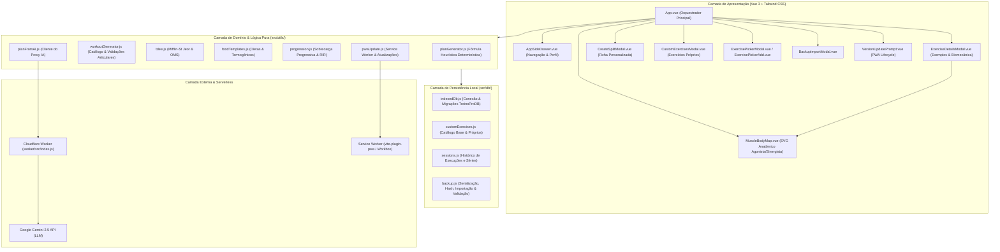
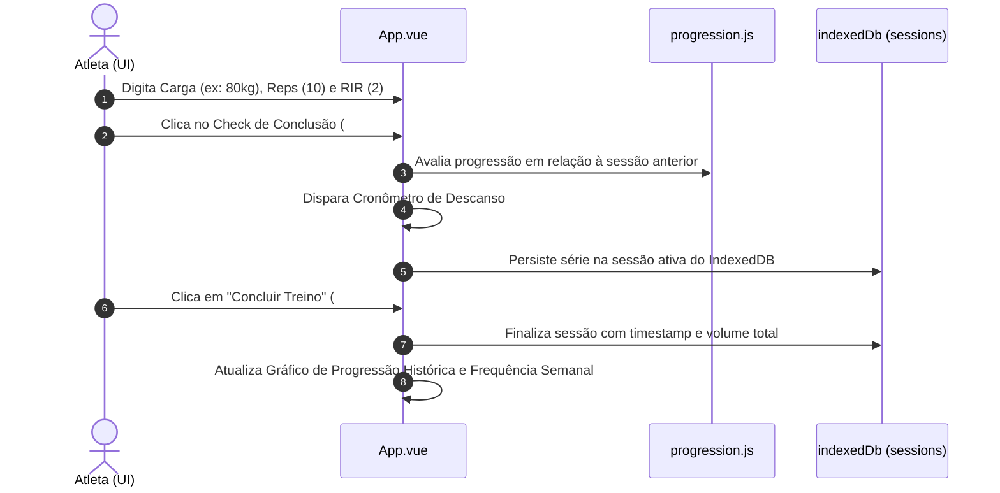

# Arquitetura do Sistema — TreinoPro

## 1. Visão Geral e Filosofia do Projeto
O **TreinoPro** é uma aplicação PWA (Progressive Web App) voltada para planejamento, acompanhamento de cargas e hipertrofia/emagrecimento de alta performance. 

O sistema opera sob o paradigma **Offline-First**, onde toda e qualquer funcionalidade crítica (execução de treino, anotação de cargas, visualização de histórico, cronômetro de descanso e plano nutricional) opera 100% de forma local no navegador do usuário, com persistência no IndexedDB. Recursos de nuvem e IA (Google Gemini 2.5) atuam como aprimoramentos assíncronos desacoplados através de um proxy serverless (Cloudflare Worker).

---

## 2. Diagrama Arquitetural em Camadas

---

## 3. Detalhamento das Camadas

### 3.1 Camada de Apresentação (`src/components/` e `src/App.vue`)
- **Padrão:** Single-File Components (SFC) com Composition API (`<script setup>`).
- **Estado Reativo:** Estados locais organizados por domínio com `ref`, `reactive`, `computed` e `watch`.
- **Comunicação entre Componentes:**
  - Fluxo unidirecional de dados via **Props**.
  - Notificação de eventos para cima via **`defineEmits`** fortemente tipados conceitualmente.
  - Ausência de bibliotecas pesadas de estado global (Pinia/Vuex): a persistência centralizada no IndexedDB atua como Fonte Única da Verdade (*Single Source of Truth*), garantindo integridade e ausência de descompasso de cache em memória.
- **Identificadores de Testabilidade:**
  - Todos os elementos acionáveis ou de validação contêm IDs fixos explícitos (ex: `#btn-open-menu`, `#app-side-drawer`, `#exercise-details-modal`, `#btn-check-${exerciseId}`).

### 3.2 Camada de Domínio (`src/utils/`)
- **Funções Puras:** Módulos isolados de I/O, amplamente testáveis sem necessidade de mocks de DOM.
- **`planGenerator.js`:** Algoritmo heurístico que projeta fichas ABC, ABCD ou ABCDE baseado no número de dias, equipamento (academia, halteres, peso do corpo), nível do atleta e restrições articulares (ex: dor no joelho, ombro ou lombar).
- **`workoutGenerator.js`:** Banco taxonômico contendo mapeamento de sinergia muscular, padrão biomecânico (`push_horizontal`, `hinge`, `squat`, etc.), e compatibilidade articular.
- **`tdee.js`:** Implementação clínica de equações fisiológicas (Mifflin-St Jeor) com cálculo de Taxa Metabólica Basal, Gasto Energético Total (TDEE), déficit para emagrecimento seguro (-500 kcal) e distribuição de macronutrientes (proteínas, carboidratos e gorduras).
- **`progression.js`:** Algoritmo que calcula sobrecarga progressiva entre sessões consecutivas de treino, deltas de volume e Repetições em Reserva (RIR).

### 3.3 Camada de Persistência (`src/db/`)
- **Banco:** IndexedDB (`TreinoProDB`).
- **Object Stores:**
  - `profile`: Perfil do atleta (nome, idade, peso, altura, restrições, nível, dias).
  - `activePlan`: Ficha de treino ativa, divisões e seleção de exercícios.
  - `sessions`: Registro cronológico imutável de treinos realizados com séries, repetições, carga (kg), RIR e duração.
  - `customExercises`: Exercícios adicionados manualmente pelo usuário.
  - `weeklyCalendar`: Dias da semana cumpridos no ciclo atual.
- **Segurança de Dados e Backups (`backup.js`):**
  - Exportação e importação em formato JSON normalizado (`treinopro-backup-*.json`).
  - Validação estrita de schema antes da importação para evitar corrupção de banco.
  - Atomicidade na substituição de dados.

### 3.4 Camada de IA e Serverless (`worker/`)
- **Worker (`worker/src/index.js`):**
  - Executado no Cloudflare Workers runtime.
  - Sanitização de payload: o nome do usuário e dados identificáveis são expressamente omitidos no envio, mantendo anonimização.
  - Timeout resiliente com `AbortController`.
  - Validação de saída: o JSON retornado pelo Gemini é validado contra o catálogo nativo de exercícios para garantir que a IA não invente exercícios inexistentes ou perigosos às restrições do atleta.

---

## 4. Fluxo de Dados Crítico: Ciclo de Treino e Carga

---

## 5. Diretrizes de Extensibilidade
1. **Novos Recursos de Apresentação:** Devem ser desacoplados em componentes dedicados em `src/components/`, emitindo eventos claros para o orquestrador.
2. **Novos Cálculos Fisiológicos ou Biomecânicos:** Devem residir em `src/utils/` como funções puras exportadas, acompanhadas de testes unitários no Vitest.
3. **Novas Tabelas ou Campos de Persistência:** Devem ser versionados no upgrade handler de `src/db/indexedDb.js`, com suporte obrigatório nas rotinas de exportação/importação do `backup.js`.
