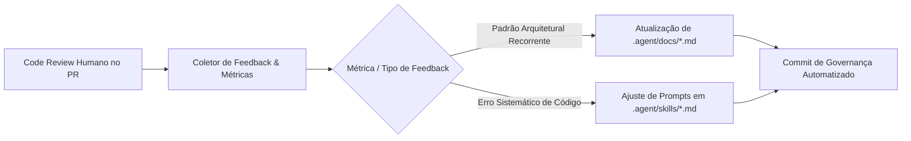
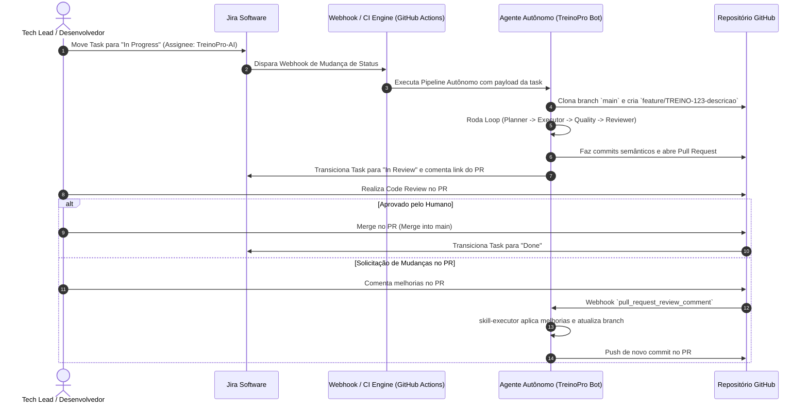

# Fluxo Autônomo, Ciclos de Feedback e Pipeline Jira/Git — TreinoPro

Este documento formaliza a arquitetura operacional da esteira autônoma de desenvolvimento de software (SDLC) para o TreinoPro, detalhando o loop de refinamento autônomo, o protocolo de melhoria contínua e a integração de automação com Jira e Git.

---

## 1. Loop Autônomo de Refinamento (Autocorreção)

```mermaid
flowchart TD
    TaskIn["Demanda (Jira Task / Issue)"] --> Planner["1. skill-planner (Gera Plano & Checklist)"]
    Planner --> Executor["2. skill-executor (Implementa Código & Testes)"]
    Executor --> Quality["3. skill-quality (Build + Testes Unitários + E2E)"]
    
    Quality -->|Falha nos Testes / Build| CheckIter1{"Iterações < 3?"}
    CheckIter1 -->|Sim| Executor
    CheckIter1 -->|Não (Limite Atingido)| AlertHuman["Alerta: Limite de Autocorreção Excedido"]
    
    Quality -->|100% Testes Aprovados| Reviewer["4. skill-reviewer (Auditoria Arquitetural 4 Pilares)"]
    Reviewer -->|Apontamentos Bloqueantes| CheckIter2{"Iterações < 3?"}
    CheckIter2 -->|Sim| Executor
    CheckIter2 -->|Não (Limite Atingido)| AlertHuman
    
    Reviewer -->|Aprovado sem Bloqueios| ReadyHuman["5. PR Aberto & Sinalização para Code Review Humano"]
    AlertHuman --> HumanDev["Intervenção de Engenheiro Humano"]
    ReadyHuman --> HumanDev
```

### 1.1 Regras de Operação do Loop
1. **Iteração Máxima:** O loop de autocorreção automática entre `executor` ⇄ `quality`/`reviewer` tem limite estrito de **2 a 3 iterações**. Isso impede loops infinitos e consumo desnecessário de tokens.
2. **Contexto Incremental de Correção:** Ao retornar para a `skill-executor`, o payload de reexecução contém exclusivamente:
   - O plano original.
   - O traceback ou log exato da falha emitido pela `skill-quality` ou os apontamentos categorizados da `skill-reviewer`.
   - Instrução imperativa para focar apenas na resolução do apontamento sem regredir o restante.
3. **Escalonamento Humano:** Caso a 3ª iteração falhe, o bot não força um merge: ele abre o PR com a etiqueta `status: needs-human-review`, anexando o relatório das 3 tentativas e os logs da falha.

---

## 2. Ciclo de Melhoria Contínua (Feedback Loops)



### 2.1 Coleta de Métricas de Performance do Agente
A plataforma monitora e armazena os seguintes KPIs por ciclo de desenvolvimento:
- **Taxa de Resolução na 1ª Tentativa (First-Pass Success Rate):** Porcentagem de tasks aprovadas sem precisar do loop de retorno.
- **Número Médio de Iterações de Autocorreção:** Índice de convergência da `skill-executor`.
- **Tipo de Falha Mais Frequente:** (1. Seletor de DOM E2E, 2. Tipagem/Asserção, 3. Estilo/Contraste).
- **Volume e Taxa de Ajustes Solicitados pelo Revisor Humano pós-loop.**

### 2.2 Protocolo de Retroalimentação Automática (Self-Learning Routine)
Quando um desenvolvedor humano comenta no Pull Request apontando uma oportunidade de melhoria sistemática (ex: *"Lembre-se que todo modal novo precisa fechar no backdrop com blur"* ou *"Sempre incluir a tag de equipamento no ExerciseDetailsModal"*):
1. O pipeline extrai a diretriz do comentário.
2. O agente executa a rotina de atualização:
   - Se for uma convenção geral: insere a nova regra em `.agent/docs/conventions.md` ou `.agent/docs/guidelines-for-agents.md`.
   - Se for um critério de planejamento: adiciona a validação na checklist da `skill-planner.md`.
   - Se for uma asserção de teste: adiciona a regra de verificação na `skill-quality.md`.
3. Um commit de governança é gerado: `chore(agent-governance): update conventions based on PR #123 review`.

---

## 3. Pipeline de Automação End-to-End (Jira & Git)

### 3.1 Diagrama de Integração Completa



---

## 4. Blueprint Técnico de Implementação

### 4.1 Script CLI Orquestrador (`scripts/agent-task-runner.sh`)
```bash
#!/usr/bin/env bash
set -euo pipefail

TASK_ID="${1:-}"
TASK_SUMMARY="${2:-}"

if [ -z "$TASK_ID" ]; then
  echo "Erro: TASK_ID é obrigatório. Uso: ./agent-task-runner.sh <TASK_ID> <SUMMARY>"
  exit 1
fi

BRANCH_NAME="feature/${TASK_ID}"
echo "Iniciando esteira para $TASK_ID na branch $BRANCH_NAME..."

git checkout -b "$BRANCH_NAME"

# 1. Execução da skill-planner
echo ">> Executando skill-planner..."
# (Invocação de prompt com escopo da task + docs)

# 2. Execução da skill-executor & Loop de Autocorreção (máx 3 tentativas)
MAX_ITERATIONS=3
ITERATION=1
SUCCESS=0

while [ "$ITERATION" -le "$MAX_ITERATIONS" ]; do
  echo ">> Tentativa $ITERATION de $MAX_ITERATIONS..."
  
  # Executa código
  # Executa skill-quality
  if npm run build && npm test -- --run; then
    echo ">> Build e testes unitários aprovados com sucesso!"
    SUCCESS=1
    break
  else
    echo ">> Falha de validação na iteração $ITERATION. Coletando logs para autocorreção..."
    ITERATION=$((ITERATION + 1))
  fi
done

if [ "$SUCCESS" -eq 1 ]; then
  echo ">> Todas as validações aprovadas. Commitando alterações..."
  git add .
  git commit -m "feat(${TASK_ID}): implementa ${TASK_SUMMARY} conforme especificações"
  git push origin "$BRANCH_NAME"
  echo ">> Pronto para abertura de Pull Request."
else
  echo ">> Limite de iterações atingido sem estabilização. Notificando desenvolvedor..."
  exit 1
fi
```

### 4.2 GitHub Actions Workflow (`.github/workflows/agent-ci.yml`)
```yaml
name: Agent Autonomous CI & Quality Gate

on:
  pull_request:
    branches: [ main ]
  workflow_dispatch:
    inputs:
      jira_task:
        description: 'Jira Task ID (ex: TREINO-42)'
        required: true

jobs:
  validate-agent-code:
    runs-on: ubuntu-latest
    steps:
      - name: Checkout Repository
        uses: actions/checkout@v4

      - name: Setup Node.js 20
        uses: actions/setup-node@v4
        with:
          node-version: 20
          cache: 'npm'

      - name: Install Dependencies
        run: npm ci

      - name: Production Build Check (PWA)
        run: npm run build

      - name: Run Unit Tests (Vitest)
        run: npm test -- --run

      - name: Install Playwright Browsers
        run: npx playwright install --with-deps chromium

      - name: Run E2E Tests (Playwright)
        run: npx playwright test

      - name: Audit Against Agent Guidelines
        run: |
          echo "Auditando código contra .agent/docs/conventions.md e architecture.md..."
```
