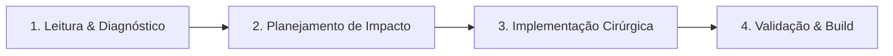

# Diretrizes Operacionais para Agentes de IA — TreinoPro

Este guia é a especificação normativa de como agentes de IA autônomos devem inspecionar, raciocinar, modificar e validar código dentro deste repositório sem quebrar o ecossistema existente.

---

## 1. Princípios Fundamentais de Operação

### 1.1 Invariância de Testes (Regra de Ouro)
- **O código NUNCA pode ser entregue com testes quebrados.**
- O repositório possui mais de 400 testes unitários no Vitest e suítes completas de Playwright. Qualquer alteração que introduza falhas em testes existentes é sumariamente rejeitada.
- Se uma nova funcionalidade for adicionada, os testes correspondentes (unitários e/ou E2E) **devem ser criados no mesmo commit**.

### 1.2 Preservação de Identificadores do DOM (IDs)
- Os testes E2E do Playwright dependem dos IDs padronizados (ex: `#btn-open-menu`, `#tab-btn-workout`, `#input-weight-*`).
- **NUNCA delete, renomeie ou remova um ID sem atualizar a respectiva suíte de testes.**
- Se novos botões, inputs ou modais forem introduzidos, declare IDs semânticos seguindo `conventions.md`.

### 1.3 Preservação de Documentação e Comentários Existentes
- Mantenha comentários de contexto biomecânico, fórmulas e anotações médicas existentes, a menos que o usuário solicite explicitamente a remoção.

---

## 2. Protocolo de Raciocínio e Modificação (Ciclo de 4 Passos)



### Passo 1: Leitura e Diagnóstico
- Inspecione primeiro os arquivos relacionados ao problema antes de editar.
- Verifique se a mudança afeta:
  - Componentes de UI (`src/components/`, `src/App.vue`).
  - Lógica de domínio (`src/utils/`).
  - Persistência IndexedDB (`src/db/`).
  - Testes associados (`tests/unit/`, `tests/e2e/`).

### Passo 2: Planejamento de Impacto
- Identifique os arquivos satélites impactados.
- Se a alteração envolver novo estado ou componente, avalie se o menu lateral (`AppSideDrawer.vue`) ou modais existentes precisam refletir esse estado.
- Garanta que dados estruturados persistam no IndexedDB e possam ser incluídos no backup do `src/db/backup.js`.

### Passo 3: Implementação Cirúrgica
- Faça edições focadas. Não reescreva arquivos inteiros quando apenas um bloco precisar de ajustes.
- Respeite as convenções de Tailwind CSS e as cores da identidade visual (`#0077ff` azul elétrico, `#00c48c` menta, `#ff6b4a` energia).
- Garanta acessibilidade móvel: use `.tap-btn` em botões e mantenha contraste adequado.

### Passo 4: Validação & Build
- Execute imediatamente os testes unitários afetados:
  ```bash
  npm test -- <caminho_do_teste> --run
  ```
- Rode o build de produção para assegurar que Rollup/Vite não encontre tags não fechadas ou imports inexistentes:
  ```bash
  npm run build
  ```
- Rode os testes E2E pertinentes com o Playwright:
  ```bash
  npx playwright test <caminho_do_spec>
  ```

---

## 3. Gestão de Falhas e Autocorreção
Se um comando de teste ou build falhar:
1. **Analise o traceback exato:** Não tente "chutar" correções sem ler o erro retornado.
2. **Isole o elemento:** Verifique se o seletor falhou por invisibilidade, timeout ou elemento coberto por backdrop.
3. **Limite de Tentativas:** Aplique a correção mantendo no máximo 3 iterações de ajuste autônomo antes de solicitar intervenção humana.

---

## 4. Checklist Obrigatório de Pré-Entrega
Antes de concluir qualquer tarefa ou emitir um Pull Request, confirme:
- [ ] O código segue a arquitetura em camadas descrita em `architecture.md`.
- [ ] Os nomes de variáveis, arquivos e IDs seguem `conventions.md`.
- [ ] `npm test -- --run` executou e passou com 100% de sucesso.
- [ ] `npm run build` gerou a compilação de produção sem erros.
- [ ] Novos testes foram criados para cobrir novos fluxos ou edge-cases.
