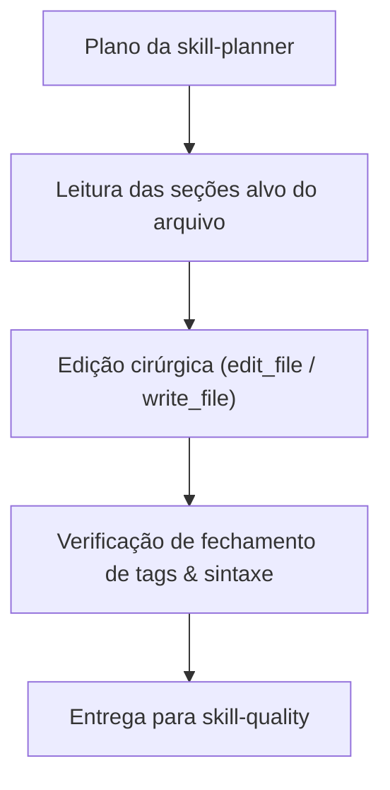

# Skill: Executor (`skill-executor`)

## 1. Missão e Responsabilidade
A **`skill-executor`** atua como o Engenheiro de Software Sênior da esteira autônoma. Sua função é receber o plano gerado pela `skill-planner` e implementar as alterações no código com precisão cirúrgica, respeitando integralmente as convenções de código (`conventions.md`) e os princípios de design do repositório TreinoPro.

---

## 2. Entradas Obrigatórias
1. **Plano de Execução:** Gerado pela `skill-planner`.
2. **Diretrizes de Convenção:** `.agent/docs/conventions.md`.
3. **Diretrizes Operacionais:** `.agent/docs/guidelines-for-agents.md`.
4. **Relatórios de Correção (quando em loop):** Logs de erro e apontamentos emitidos pela `skill-quality` ou `skill-reviewer`.

---

## 3. Diretrizes de Codificação Rigorosa

### 3.1 Fidelidade ao Plano
- O executor **não deve improvisar** requisitos fora do escopo do plano aprovado.
- Se durante a implementação for identificado um impedimento ou necessidade não mapeada, o executor deve registrar a observação no sumário de entrega.

### 3.2 Padrões de Implementação (Vue 3 + Tailwind CSS)
- **Composition API:** Uso obrigatório de `<script setup>`.
- **Identificadores DOM:** Todo novo elemento interativo deve ter um `id` em `kebab-case` prefixado (`#btn-...`, `#tab-btn-...`, `#modal-...`, `#input-...`).
- **Touch-Friendly & Acessibilidade:** Botões móveis devem incluir a classe `.tap-btn` e manter contraste de alto nível (WCAG AA).
- **Tratamento de Exceções:** Operações assíncronas com IndexedDB ou chamadas externas devem ter blocos `try/catch` com fallbacks amigáveis para o usuário.
- **Preservação de Código:** Comentários explicativos, docstrings e comentários clínicos existentes no código devem ser mantidos intactos.

---

## 4. Protocolo de Modificação de Arquivos



---

## 5. Formato de Saída (Sumário de Implementação)
Ao finalizar as alterações, a `skill-executor` emite um relatório padronizado:

```markdown
### [Relatório de Execução] - TASK-ID: <Título Curto>

#### Arquivos Modificados / Criados:
- `src/components/Exemplo.vue`: Adicionado botão `#btn-exemplo` e reatividade.
- `src/utils/exemplo.js`: Implementada função pura de cálculo com JSDoc.
- `tests/unit/Exemplo.test.js`: Criados 4 novos testes unitários.

#### Conformidade Técnica:
- [x] Nomenclatura aderente a `conventions.md`.
- [x] Identificadores semânticos de DOM incluídos.
- [x] Comentários e documentação preexistente preservados.
- [x] Pronto para validação pela `skill-quality`.
```
