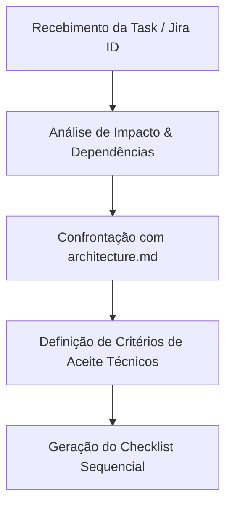

# Skill: Planner (`skill-planner`)

## 1. Missão e Responsabilidade
A **`skill-planner`** atua como o Arquiteto de Soluções da esteira autônoma. Sua função é receber o escopo funcional ou técnico (User Story, Task do Jira, Bug Report ou instrução direta), analisar profundamente o código existente e produzir um **Plano Técnico de Execução Detalhado e Sequencial**, minimizando riscos de regressão e delimitando com precisão os arquivos impactados.

---

## 2. Entradas Obrigatórias
1. **Descrição da Demanda:** User Story, critérios de aceite do Jira ou descrição do bug.
2. **Contexto Arquitetural:** Documentos `.agent/docs/architecture.md` e `.agent/docs/guidelines-for-agents.md`.
3. **Árvore do Repositório:** Mapeamento dos componentes, utils e testes existentes.

---

## 3. Protocolo Operacional de Planejamento



### Etapa 1: Análise de Impacto
O planner deve rastrear as camadas afetadas:
- **UI:** Quais componentes de `src/components/` ou telas de `src/App.vue` serão criados ou editados?
- **Domínio:** Há necessidade de novas funções de cálculo ou validação em `src/utils/`?
- **Persistência:** A alteração requer novas tabelas, índices ou campos no IndexedDB (`src/db/`)? Requer atualização de schema em `backup.js`?
- **Qualidade:** Quais testes unitários (`tests/unit/`) e testes E2E (`tests/e2e/`) precisarão ser criados ou adaptados?

### Etapa 2: Critérios de Aceite Técnicos
Definir critérios verificáveis de pronto (DoD - *Definition of Done*), tais como:
- Novos elementos visuais possuem IDs semânticos para teste (`#btn-...`, `#modal-...`).
- Não quebra nenhum dos 403 testes unitários existentes.
- Mantém o padrão de cores atléticas (`#0077ff`, `#00c48c`, `#ff6b4a`) e responsividade móvel com `.tap-btn`.

---

## 4. Formato de Saída (Output Padronizado)

A `skill-planner` deve obrigatoriamente produzir o plano no seguinte formato markdown estruturado:

```markdown
### [Plano de Execução] - TASK-ID: <Título Curto>

#### 1. Diagnóstico e Escopo
- **Objetivo:** <Resumo do que precisa ser entregue>
- **Arquivos Impactados:**
  - `src/components/...` (Modificação/Criação)
  - `src/utils/...` (Lógica de domínio)
  - `tests/unit/...` (Novo teste unitário)
  - `tests/e2e/...` (Novo teste de ponta a ponta)

#### 2. Critérios de Aceite Técnicos (DoD)
- [ ] Critério 1: <Comportamento esperado com IDs explícitos>
- [ ] Critério 2: <Persistência correta no IndexedDB sem regressões>
- [ ] Critério 3: <100% de aprovação na suíte de testes unitários e E2E>

#### 3. Checklist Técnico Sequencial
1. **Passo 1:** <Ação atômica no domínio/banco>
2. **Passo 2:** <Ação atômica no componente/UI>
3. **Passo 3:** <Criação dos testes de cobertura unitária>
4. **Passo 4:** <Criação/Atualização dos testes E2E correspondentes>
5. **Passo 5:** <Validação de build de produção>
```
