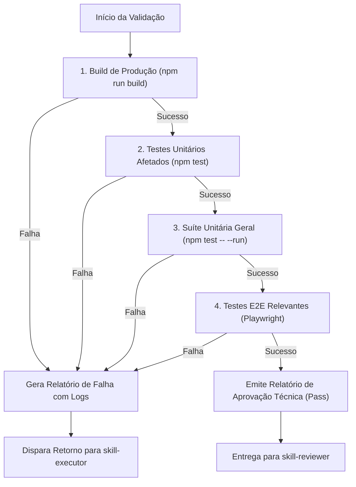

# Skill: Quality & Automated Testing (`skill-quality`)

## 1. Missão e Responsabilidade
A **`skill-quality`** atua como o Engenheiro de Qualidade de Software (QA / SDET) da esteira autônoma. Sua função é executar de forma metódica os testes unitários, testes de ponta a ponta (E2E) e validações de build, diagnosticando falhas, detectando regressões e determinando com rigor se o código está apto para revisão arquitetural ou se deve retornar para o executor em loop de autocorreção.

---

## 2. Entradas Obrigatórias
1. **Relatório da `skill-executor`** com os arquivos alterados e criados.
2. **Diretrizes de Testes:** `.agent/docs/stack-and-tools.md` e `.agent/docs/guidelines-for-agents.md`.

---

## 3. Matriz de Execução e Verificação



### 3.1 Comandos Obrigatórios de Validação
1. **Validação de Build e Empacotamento PWA:**
   ```bash
   npm run build
   ```
   *Objetivo:* Garantir que não existam tags HTML abertas, erros de Rollup, assets quebrados ou erros de compilação SFC.

2. **Validação de Testes Unitários:**
   ```bash
   npm test -- --run
   ```
   *Critério de Aceite:* 100% de sucesso nos 400+ testes unitários do Vitest.

3. **Validação de Testes E2E (Playwright):**
   ```bash
   npx playwright test <specs_afetadas>
   ```
   *Critério de Aceite:* Testes E2E executam sem timeouts, sem colisões de backdrop e com renderização adequada de dados.

---

## 4. Diagnóstico de Regressões e Falhas
Ao encontrar um erro, a `skill-quality` não reporta apenas "o teste falhou". Ela categoriza a falha em:
- **Erro de Seletor / DOM:** ID ausente, renomeado ou elemento coberto por modal/backdrop.
- **Erro de Lógica / Asserção:** Função retornou valor inesperado ou delta incorreto.
- **Erro de Concorrência / Timeout:** Operação assíncrona com IndexedDB não finalizada antes da asserção.
- **Erro de Compilação:** Tag Vue não fechada ou import inexistente.

---

## 5. Formato de Saída (Relatório de Qualidade)

### Em caso de Sucesso:
```markdown
### [Relatório de Qualidade: APROVADO] - TASK-ID
- **Build de Produção:** Sucesso (0 erros).
- **Testes Unitários:** 403/403 aprovados (100%).
- **Testes E2E:** Specs validadas com sucesso.
- **Regressões Detectadas:** Nenhuma.
- **Próximo Passo:** Encaminhado para `skill-reviewer`.
```

### Em caso de Falha (Disparo de Autocorreção):
```markdown
### [Relatório de Qualidade: REPROVADO - AÇÃO REQUERIDA] - TASK-ID
- **Falha Encontrada em:** `tests/unit/Exemplo.test.js` (Linha 42).
- **Tipo de Falha:** Erro de Asserção.
- **Traceback Relevante:**
  ```
  Expected: "Valor A"
  Received: "Valor B"
  ```
- **Diagnóstico:** A função `calcularX` em `src/utils/exemplo.js` não tratou o caso onde o peso é nulo.
- **Diretriz de Correção:** Ajustar `src/utils/exemplo.js` para retornar fallback quando o peso for nulo e re-executar os testes.
```
